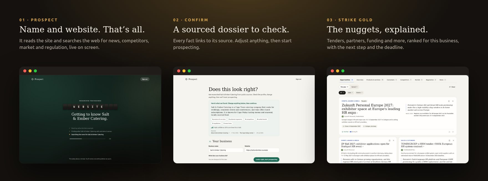
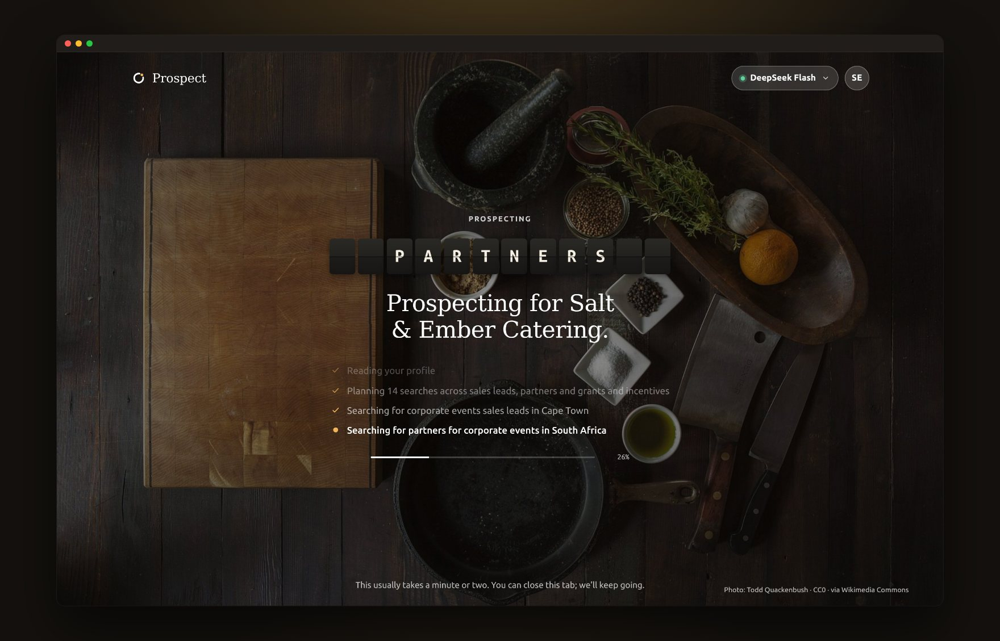
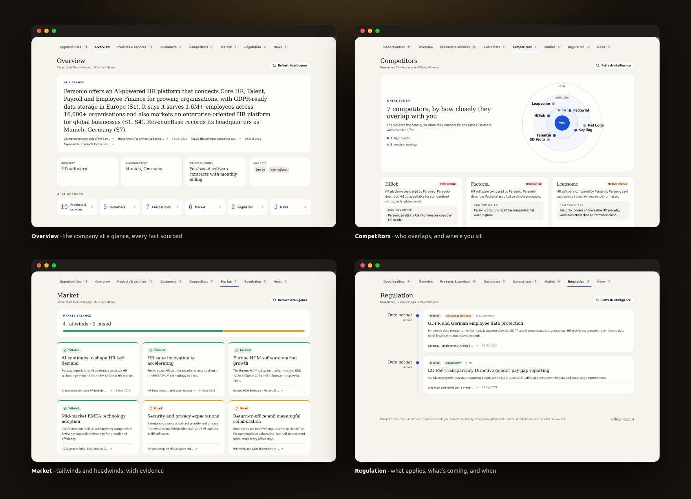
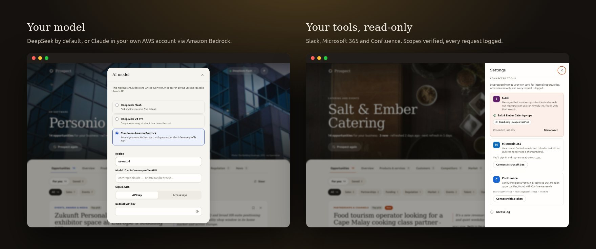

<p align="center">
  <picture>
    <source media="(prefers-color-scheme: dark)" srcset="docs/assets/banner-dark.svg">
    
  </picture>
</p>

<p align="center">
  <b>Give Prospect a business name and a website.</b> It researches the business, prospects the market every week, and brings back the opportunities worth acting on: tenders, partners, funding, rule changes, new markets. <b>Every one sourced. Every one explained.</b>
</p>

<p align="center">
  <a href="#the-problem">The problem</a>&nbsp;&nbsp;·&nbsp;&nbsp;<a href="#evidence">Evidence</a>&nbsp;&nbsp;·&nbsp;&nbsp;<a href="#opportunity-and-why-now">Why now</a>&nbsp;&nbsp;·&nbsp;&nbsp;<a href="#what-success-looks-like">Success</a>&nbsp;&nbsp;·&nbsp;&nbsp;<a href="#how-it-works">How it works</a>&nbsp;&nbsp;·&nbsp;&nbsp;<a href="#run-it">Run it</a>
</p>

<p align="center"></p>
<p align="center"><sub>Real output, not a mock-up: Personio researched and prospected live from public sources. Fourteen open opportunities in about two minutes.</sub></p>

<table>
<tr>
<td width="33%" valign="top">
<h3>Sourced, never invented</h3>
Every fact and every opportunity links to where it came from. Anything unsourced is dropped by the data layer itself, and a section with nothing reliable is simply not shown.
</td>
<td width="33%" valign="top">
<h3>Every kind of opportunity</h3>
Tenders and buying signals, partners, funding and incentives, regulation, new markets, events and awards, talent and suppliers, each judged against <i>this</i> business.
</td>
<td width="33%" valign="top">
<h3>Read-only by design</h3>
Slack, Microsoft 365 and Confluence connect strictly read-only, enforced in four independent layers, with every request logged for you to see.
</td>
</tr>
</table>

## The problem

> [!NOTE]
> **Who it's for:** owner-managers and business-development leads at small and mid-sized B2B companies, roughly 10 to 200 people, with no dedicated bid, partnerships or market-intelligence team.

In these companies, finding growth opportunities is nobody's full-time job. A tender is spotted because someone happened to open the right portal that week; a partner programme because a contact mentioned it; a grant or a new regulation after the deadline that mattered. The searching is scattered across tender portals, newsletters, LinkedIn, industry sites and inboxes, so the opportunities that fit the business best are routinely **missed, found late, or found by a competitor first**, while the team already knows about a few of the obvious ones.

**The scope is deliberately narrow:** find the external opportunities a specific business is missing, and explain why each one fits it. Not a CRM, not a contact database, not a dashboard of internal metrics.

## Evidence

### What the numbers say

<table>
<tr><td width="150"><h3>710,000</h3></td><td>small formal businesses in South Africa in 2022, out of an estimated <b>2.67 million</b> SMMEs (<a href="https://www.tips.org.za/images/REB_The_State_of_Small_Business_in_South_Africa_2024_.pdf">TIPS</a>, <a href="https://www.absa.co.za/business/absa-small-business-growth-index-2025/">Absa SBGI</a>)</td></tr>
<tr><td><h3>15% of GDP</h3></td><td>flows through public procurement, <b>76%</b> of it through provinces, municipalities and public entities: thousands of buyers and no single place to watch them (<a href="https://www.imf.org/-/media/files/publications/selected-issues-papers/2023/english/sipea2023041.pdf.md">IMF, 2023</a>). Even National Treasury's eTender portal says its data is incomplete, because sharing is voluntary for some entities (<a href="https://data.open-contracting.org/en/publication/143">Open Contracting</a>)</td></tr>
<tr><td><h3>52.8%</h3></td><td>of South African SMMEs were in contraction, difficulty or at risk of closure in 2025. For them, finding the next opportunity isn't optional (<a href="https://www.absa.co.za/business/absa-small-business-growth-index-2025/">Absa SBGI</a>)</td></tr>
</table>

### What we saw building it

Live runs on real businesses, public information only:

| Business | What research found | What prospecting found | Cost · time |
|:--|:--|:--|:--|
| **Personio**<br><sub>HR software · B2B</sub> | 10 offerings, 5 customer segments, 7 competitors, 6 market trends, 2 rules that apply (the EU AI Act for HR, German employee-data law), 5 news items · 82% confidence | **14 open opportunities**, including a **€660k e-HRM tender** and exhibitor places at **Zukunft Personal Europe 2027**, most confirmed by reading the page itself | ≈ US$0.04<br>≈ 2 min |
| **SweepSouth**<br><sub>home services · South Africa</sub> | 5 real local competitors, the R30.23/hour minimum wage, a draft wage law | **1, then 7** open opportunities after the change below, including a provincial home-based-care tender | ≈ US$0.05<br>≈ 2.5 min |

> [!TIP]
> **What we learned:** a consumer-facing business has few formal tenders, so a tool that only watches tenders fails it. We changed the engine to plan its searches from the business model (partner and supplier programmes, expansion, awards, funds and skills programmes for consumer businesses; tenders and procurement for B2B) and to accept genuine informal openings. SweepSouth went from one opportunity to seven. The need is broad, and only a business-specific approach meets it.

**Next validation step:** a pilot with ten owner-managers, measuring the targets below on their own businesses.

## Opportunity and why now

| Today's option | What it does | What it misses |
|:--|:--|:--|
| Tender-alert subscriptions | keyword alerts on tenders | everything that isn't a tender, and any judgement of fit |
| Google Alerts | raw mentions | structure, relevance, deadlines |
| Sales-intelligence tools | contact data | the opportunities themselves; priced for larger sales teams |
| Competitive-intelligence platforms | competitor tracking | the rest of the market; enterprise pricing |
| Consultants | periodic reports | continuity, and cost |

None of them builds an understanding of *this* business first and then looks across every kind of opportunity for it.

**The cost of the status quo** is time and missed revenue. As an illustrative assumption, three hours a week scanning portals, newsletters and news is about **150 hours a year**, and it still misses what never reaches the inbox.

**Why now:** AI search and page-reading APIs make continuous, sourced research cheap. Measured in our live runs, researching a business costs about **US$0.015** and a full prospecting run **US$0.02–0.04**, so a weekly refresh costs **well under US$1 per business per month**.

## What success looks like

| Outcome | Target | Live so far |
|:--|:--|:--|
| **Truth** | 100% of facts and opportunities linked to a source; ≥ 90% of facts confirmed correct by the owner | 100% sourced, enforced by the data layer |
| **Relevance** | ≥ 5 open, relevant opportunities on the first run; ≥ 50% rated worth pursuing | Personio 14 · SweepSouth 7 |
| **New perspective** | ≥ 30% of opportunities the team hadn't already seen | measured in the pilot |
| **Speed** | sign-up to first opportunities in under 5 minutes | about 2–3 minutes |
| **Cost** | under US$1 per business per month at a weekly refresh | about US$0.15–0.25 |

**In scope:** researching a business from its name and website, a sourced intelligence dossier, finding and explaining opportunities across eight focus areas, scheduled refreshes, digests, read-only connectors to internal tools.
**Out of scope:** acting on opportunities (outreach, bid writing), CRM and contact lists, legal advice on regulation, full market-research reports, consumers.

## How it works

<p align="center"></p>

While it works, the prospecting board shows what it's searching for, live. Research reads the business's own site first, then the web for news, competitors, market trends and regulation. Prospecting plans searches across every focus area from that picture, reviews what comes back, reads the top picks' pages to confirm they're open, and explains each one. It then refreshes on a schedule, weekly by default, marking new finds and pruning stale ones, with a digest by email.

<p align="center"></p>

## The dossier

Behind every opportunity is a dossier of the business, built from its own site first and the public web second. A tab appears only when research found something it can source, and customers are described as segments, never as lists.

<p align="center"></p>

## Your model, your data

<p align="center"></p>

**Choose the model** that researches, judges and writes: **DeepSeek Flash** (default), **DeepSeek V4 Pro**, or **Claude on Amazon Bedrock** in your own AWS account, with your model ID or inference-profile ARN and a Bedrock API key or IAM keys (SigV4). Keys are encrypted at rest and never sent back to the browser. Web search always runs on DeepSeek's Search API.

**Connect your tools, read-only.** Slack, Microsoft 365 (Outlook mail and calendar) and Confluence let Prospect find the opportunities in your own work, and skip the ones your team is already on. Read-only is enforced in four independent layers, so no single bug can turn a read into a write:

1. **The credential can't write:** only read scopes are ever requested.
2. **Granted scopes are verified** on connect, on every refresh and, for Slack, on every call. A token that can write is refused.
3. **There is no code path that writes:** all data access goes through one gateway whose only method is HTTP GET, to allow-listed hosts and exact read endpoints, with redirects and method-override headers refused.
4. **The AI never gets tools:** connectors are called by deterministic code, and the model only ever sees text.

Every request, and every refusal, is in the access log. Guides for administrators: [Slack](docs/connectors/slack.md) · [Microsoft 365](docs/connectors/microsoft.md) · [Confluence](docs/connectors/confluence.md).

## Run it

```bash
cp .env.example .env    # add your DEEPSEEK_API_KEY
./run.sh                # builds the release binary and starts it
```

Open **http://localhost:8080** and create a business account.

<details>
<summary><b>Configuration</b></summary>
<br>

Environment variables, or a `.env` file in the working directory:

| Variable | Default | |
|---|---|---|
| `DEEPSEEK_API_KEY` | — | required for research and prospecting |
| `DEEPSEEK_MODEL` | `deepseek-flash` | default model |
| `ADDR` | `127.0.0.1:8080` | `0.0.0.0:8080` behind a proxy or in Docker |
| `PUBLIC_URL` | `http://localhost:8080` | links in emails, OAuth callbacks, secure cookies when https |
| `DATA_DIR` | `./data` | database, theme photos, outbox, `secret.key` |
| `SECRETS_KEY` | generated | base64 32-byte key that encrypts stored credentials (else `DATA_DIR/secret.key`) |
| `MAILGUN_API_KEY`, `MAILGUN_DOMAIN`, `MAILGUN_SENDER_EMAIL` | — | real email; otherwise emails go to `DATA_DIR/outbox` |
| `SLACK_CLIENT_ID`, `SLACK_CLIENT_SECRET` | — | Slack OAuth app (a Slack user token can also be pasted) |
| `MS_CLIENT_ID`, `MS_CLIENT_SECRET`, `MS_TENANT` | —, —, `organizations` | Microsoft Entra app |
| `ATLASSIAN_CLIENT_ID`, `ATLASSIAN_CLIENT_SECRET` | — | Atlassian OAuth app (an API token can also be pasted) |
| `DAILY_SPEND_LIMIT_USD` | `1.00` | stops AI runs for the day past this DeepSeek spend |
| `DEFAULT_FREQUENCY` | `weekly` | refresh cadence for new accounts |

</details>

<details>
<summary><b>Development and tests</b></summary>
<br>

```bash
cargo test --workspace     # 362 Rust tests; no network, no spend
scripts/e2e.sh             # release build + mock upstreams + the real server + the browser suite
python3 tests/mock/server.py --port 9911   # one mock for DeepSeek, Bedrock, Openverse, Commons, Mailgun, Slack, Microsoft, Atlassian
```

A `Dockerfile` (distroless, non-root) is included.

</details>

## Under the hood

One small Rust binary, about 7 MB and about 8 MB of memory at rest, with SQLite inside. No framework, no async runtime, and no build step for the web client.

<table>
<tr><td><code>crates/engine</code></td><td>research and prospecting pipelines on DeepSeek's Search, Fetch and chat APIs</td></tr>
<tr><td><code>crates/server</code></td><td>accounts, the HTTP API, background runs, the scheduler</td></tr>
<tr><td><code>crates/connectors</code></td><td>hard read-only Slack, Microsoft 365 and Confluence</td></tr>
<tr><td><code>crates/bedrock</code> · <code>crates/vault</code></td><td>Claude on Amazon Bedrock (Converse API, SigV4) · secrets encrypted at rest</td></tr>
<tr><td><code>crates/imagery</code> · <code>crates/mailer</code></td><td>the themed background photo · digests through Mailgun</td></tr>
<tr><td><code>web/</code></td><td>the whole client: three hand-written files</td></tr>
</table>

Read more: [architecture](docs/ARCHITECTURE.md) · [HTTP API](docs/API.md) · [development](docs/DEVELOPMENT.md)
